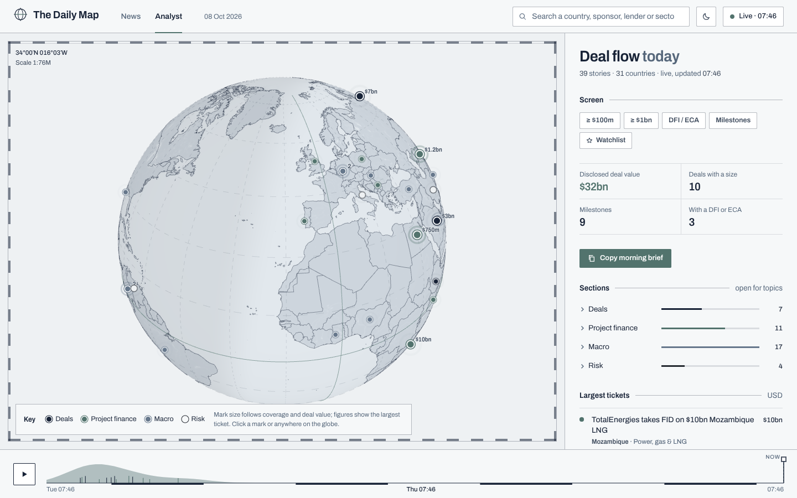
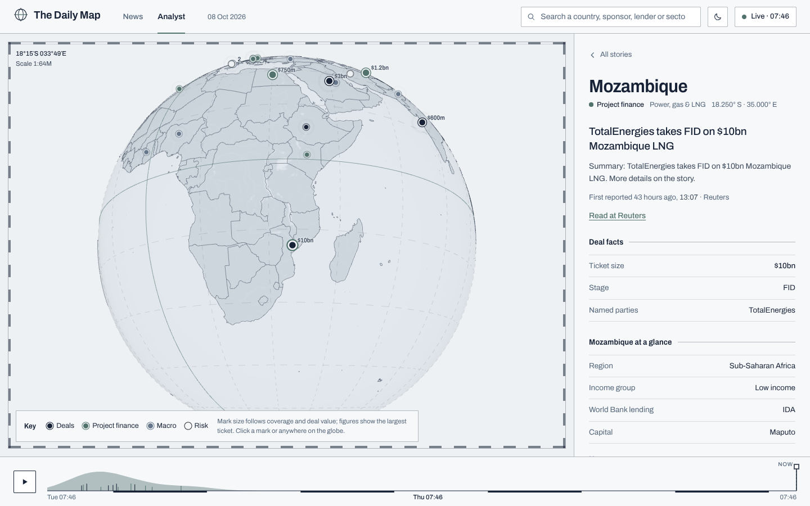
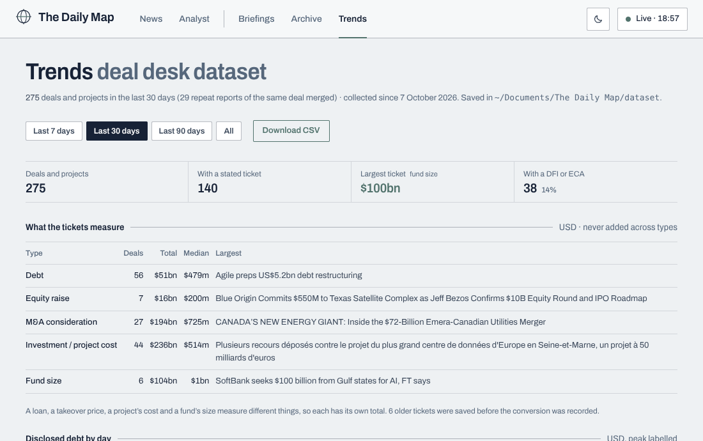
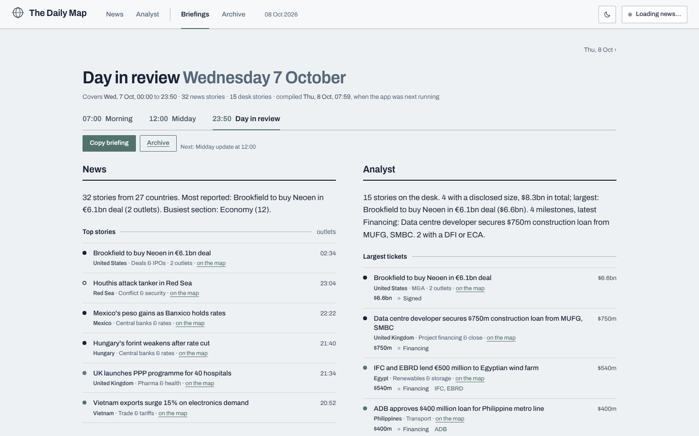
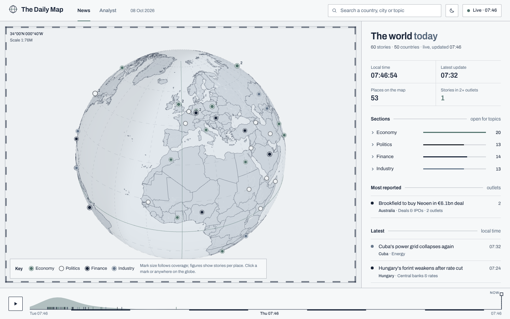
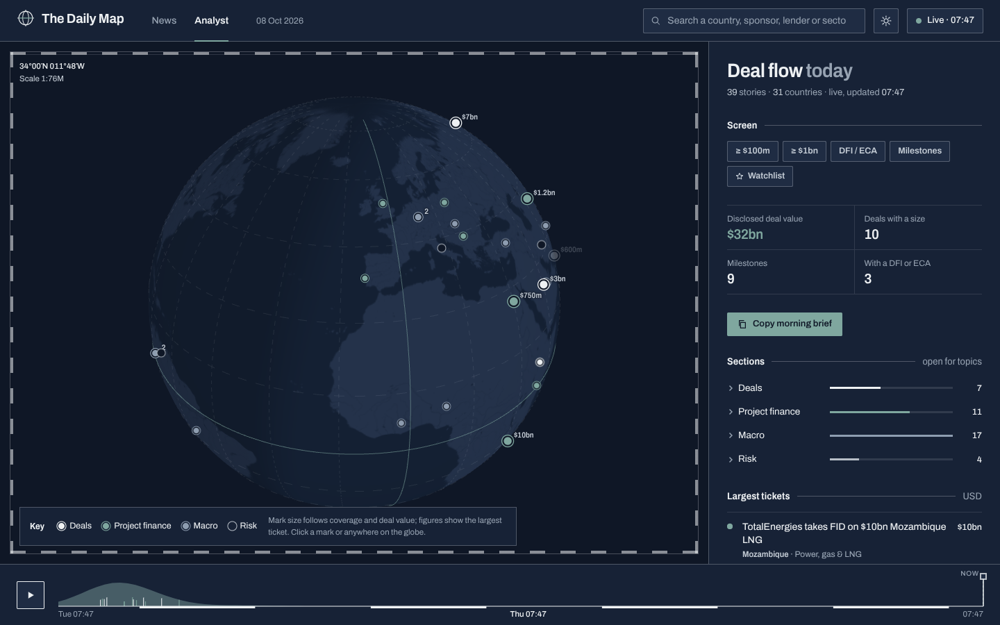
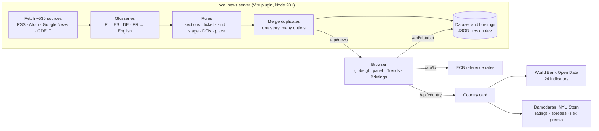

# The Daily Map

**A deal desk's morning scan on one screen.** World news on a globe, read the way a project finance and investment
banking desk reads it: what the ticket is and what it measures, how far the deal has got, who is lending, and the
country risk behind it. ~530 sources in five languages (English, Polish, Spanish, German, French), no ads, and no AI
model in the reading: every figure traces back to its headline, outlet and exchange rate.

This repository is a showcase: it holds the description, recordings and screenshots of the app. **The source code
is private** and available on request (see [Source code](#source-code) below). The app runs locally: a small news
server fetches and reads the sources, and the page shows them on the globe.

42 seconds, recorded from the running app with live news ([MP4](docs/demo.mp4)). The full 2½-minute tour, with the
48-hour replay, the Archive and the dark version: [docs/tour.gif](docs/tour.gif).

## Why I built this

Working in finance means knowing what is happening in the world before someone asks you about it. Getting there meant
news sites buried under ads, pop-ups and autoplay video, the same headline from ten outlets, and trade press, central
bank releases and DFI announcements in several languages. I wanted one place, without the clutter, filtered by what I
actually follow: deals, infrastructure, macro and country risk, with every number traceable to where it came from.

## What this project shows

- **Reading deal news like a desk.** Ticket size in any currency, converted at the ECB fixing of the day the news was
  published and labelled with what it measures: debt, equity raise, M&A consideration, project cost or fund size.
  Totals are kept per type and never added across types. Stage from pipeline to financial close, DFIs and export credit
  agencies, named lenders and sponsors; each deal counted once across outlets.
- **Country risk next to every story.** Moody's sovereign rating, the rating-based default spread, country and equity
  risk premia (Damodaran, NYU Stern) and 24 World Bank indicators: macro, governance, infrastructure track record and
  external position, each with its year and regional average.
- **Five languages, not just English.** Polish, Spanish, German and French financial press read through glossaries:
  "1,2 mld zł kredytu" is a PLN 1.2bn loan, "1.200 millones de euros" EUR 1.2bn, "Windparkfinanzierung" wind farm
  financing, "50 milliards de FCFA" XOF 50bn. French brings in West and Central Africa and the Maghreb, where
  English-language business news is thin. The glossaries were audited against published bilingual finance
  dictionaries (Ministry of Finance, World Bank, IMF, CGAP, CFPB).
- **Transparent, checkable rules.** No AI model reads the news. Every story on the deal desk has a **How this was read**
  trail: the words a fact came from, the outlet, the exchange rate and its date. 388 regression checks run in CI on
  every push, and a labelling page scores the rules against hand labels with 95% intervals.
- **A dataset, not just a feed.** Every deal the app sees is saved daily. **Trends** reads it as data (tickets by type
  with totals, medians and the largest; value by day; sectors, regions, stages, the most active DFIs and countries)
  and exports every row to CSV.
- **Made for daily use.** Briefings at 07:00, 12:00 and 23:50 with an archive, a one-click morning brief, screens
  (≥ $1bn, DFI/ECA, milestones, watchlist), a 48-hour replay, and light and dark versions.

| Analyst lens: deal flow on the map | A deal: facts, how it was read, country risk |
| --- | --- |
|  |  |
| **Trends: the deal dataset** | **Briefings: the world and the desk, three times a day** |
|  |  |
| **News lens** | **Dark version** |
|  |  |

## Case study: what does the number in a headline measure?

A headline figure is only useful if you know what it is: a loan, a takeover price, a project's cost, a fund's size,
or not a deal at all. Adding them up blindly gives totals that mean nothing. These are real headlines from the live
audits and how the app reads them (each one is a regression check):

| Headline | Read as | Why |
| --- | --- | --- |
| Cabinet approves Sh45bn rescue loan for loss-making Kenya Airways | **$347m · debt** · financing | "Sh" in the Kenyan press is the shilling, converted at the day's rate; "loan" sets the type |
| Shell Takes 30% Stake in Equinor's $12B Bay du Nord Oil Project | **$12bn · project cost** | After "Equinor's", the figure describes the project, not the price of Shell's stake |
| SoftBank Seeks $100 Billion From Gulf Investors for AI-Driven Acquisition Fund | **$100bn · fund size** · pipeline | The money goes into a fund; "acquisition" describes the fund, and "seeks" means not yet raised |
| Piden ratificar préstamo … por $75 millones (El Salvador) | **$75m · debt** | In Spanish "$" is usually the peso, but in El Salvador, Ecuador and Panama it is the US dollar |
| EDF annonce la signature de prêts bancaires pour un montant de 4 milliards d'euros | **€4bn · debt** · financing | Bank loans are a financing, not banking-sector news |
| Allegro przejmie czeską Mall Group za 4 mld zł | **PLN 4bn · M&A** · signed, Czechia | Polish inflection read by stems; the target's country sets the place |
| RWE baut in Essen ein neues Rechenzentrum für 500 Mio. Euro | **€500m · project cost** · Essen | "in Essen" is the city where RWE is based … |
| Gesundes Essen wird für Familien immer teurer | not a deal, not Essen | … while "Essen" on its own is food |
| Finland attracts over €67 billion in data center investments | no ticket | A market's total, not one transaction |
| EU paid €7.9bn for Russian Arctic LNG amid record imports | no ticket | Buying a commodity is trade, not a takeover |
| Canadiens deal defenceman Struble to Predators | off the desk | Ice hockey, not M&A |

The latest live audit read 27,850 headlines from 520 sources and found 522 tickets; every misreading it turned up
became a rule fix and a regression check. Limits: everything is inferred from headlines and short summaries, so
sections, stages and amounts are a screen, not a record. A headline outside the glossaries is left out rather than
guessed.

## How it was built

This is a vibe-coded app. An AI coding assistant (Claude Code, by Anthropic) wrote the code from my prompts; I did not
write it line by line. My part was everything around the code: what to build, how the finance should work, which
sources and references to use, and whether each reading was right.

**What I did**

- **Idea and scope.** I decided what the app is for and what it shows: two lenses (the world, and the deal desk), the
  deal facts a desk needs, country risk next to every story, briefings at fixed times, and what to leave out (opinion,
  personal finance, sport, crime, market tickers).
- **Financial rules.** I set how deals should be read: what a ticket measures and that different types are never
  added together, the stages from pipeline to financial close, DFIs and ECAs, counting a deal once across outlets, and
  converting at the rate of the day the news was published.
- **Languages and references.** I brought the bilingual finance dictionaries the glossaries were audited against
  (the Ministry of Finance's Polish–English compendium, the World Bank and IMF glossaries, CGAP and CFPB) and the
  newsroom lists the sources were taken from, and checked readings in the languages I know.
- **Review.** I used the app as it grew, asked for audits on tens of thousands of live headlines and for every
  misreading to be fixed and turned into a check: the $12B that was a project's cost, the "$" that was a peso, the
  sports trade that looked like M&A.
- **Design direction.** The palette comes from my personal brand, and the look (a quiet navigational chart rather than
  a dashboard) and the typeface match my [Option Toolkit](https://github.com/z0zqa/option-toolkit-showcase).

**What the AI did**

- Wrote the JavaScript, CSS and HTML, the news server, the tests and the documentation, in many small iterations.
- Proposed the architecture: a server plugin that fetches and reads the news, glossaries that gloss foreign headlines
  into English for one set of rules, a dataset of JSON files on disk.
- Ran the live audits and the glossary audits, and explained each misreading and its fix.

**How the readings are checked**

Because I did not write the code myself, nothing is taken on trust:

- 388 regression checks (places, tickets, stages, deal merging, FX, four languages), each a headline the rules once
  misread or a known trap. CI runs them on every push.
- A live audit reads every source once and reports how the rules read the day's headlines; a glossary audit checks
  every word stem against the most frequent words of its language, so a deal word does not catch an ordinary one.
- A labelling page scores the rules against hand labels with Wilson 95% intervals.

## Architecture

Vanilla JavaScript (ES modules, no framework), Vite 8 with a small server plugin, globe.gl and three.js, no database
and no API keys. News sites don't allow direct requests from a web page, so the local server does the fetching.

## Two lenses

| | **News** | **Analyst** |
| --- | --- | --- |
| For | Keeping up with the world | Deal flow, coverage and risk monitoring |
| Sections | Economy · Politics · Finance · Industry | Deals & capital markets · Project finance & infrastructure · Macro & markets · Policy & risk |
| Shows | Most reported stories, latest news, local time and the day/night line | Disclosed deal value per type, largest tickets, milestones, DFI/ECA activity |
| Extras | | Screens, deal facts with their trail, country card, watchlist, morning brief |

## Data and licensing

- News headlines belong to their publishers. The app shows a headline with a link to the publisher's article and
  keeps no article text. Paywalled trade press is read only through public headline searches.
- World Bank Open Data (CC BY 4.0); sovereign ratings, default spreads and risk premia from Aswath Damodaran's
  publicly posted data, credited on every country card; ECB reference rates.
- Places from world-countries (ODbL) and GeoNames (CC BY 4.0); Earth textures from NASA (public domain).
- The bilingual dictionaries were consulted for term pairs only; nothing from them is copied into the app.

This is a personal news-reading tool built on public sources, not investment advice.

## Source code

The code, the 388 regression checks, the CI workflow and the full methodology (how each fact is read, the dates kept
per story, how deals are counted once, where the macro and risk data come from) are in a private repository. Access for
recruiters and reviewers is available on request: message me on [LinkedIn](https://www.linkedin.com/in/zuzannaczernicka/).

## License

© 2026 Zuzanna Czernicka. All rights reserved: see [LICENSE](LICENSE). The code is AI-written under my direction, as
described in [How it was built](#how-it-was-built).
